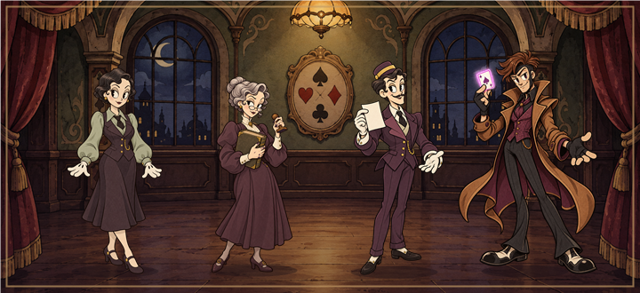

# La Casa del Azar



**[Jugar a La Casa del Azar](https://garypoui.github.io/TheGame/)**

Un videojuego educativo de probabilidad y estadística para jugar en el navegador. Estás dentro de una casa de juego y necesitás reunir tres sellos antes de desafiar al anfitrión y cruzar la puerta.

- **Las urnas de Vera.** Compará proporciones y observá cómo cambia la probabilidad al sacar fichas.
- **El duelo de Doble.** Compará tarjetas en ocho rondas. Si acertás las ocho, ganás 1 a 0.
- **El póker de Ada.** Calculá las chances de formar una mano y compará el premio de cada predicción.
- **El contrato de salida.** Combiná urnas, dados y póker en el duelo final.

El juego guarda el progreso en el navegador y ofrece ajustes de texto, sonido y movimiento.

## Ejecutar en local

Con Node.js 22.12 o posterior:

```bash
npm ci
npm run dev
```

Abrí la dirección que muestra Vite. Para generar la compilación de producción, ejecutá `npm run build`.

## Documentación

- [Diseño educativo](docs/educational-design.md)
- [Arquitectura](docs/architecture.md)
- [Pruebas y validación](docs/validation-plan.md)
- [Publicación](docs/deployment.md)
- [Créditos y licencias](https://garypoui.github.io/TheGame/credits.html)

La ilustración de esta página reúne los retratos originales de los personajes sobre la sala del juego. El proyecto usa Babylon.js, TypeScript y Vite.
